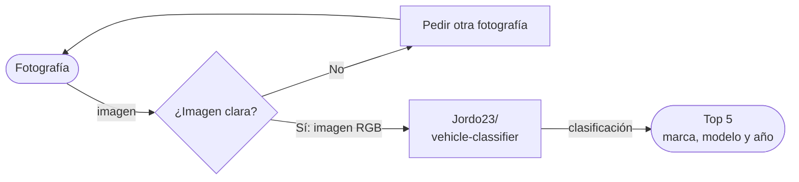
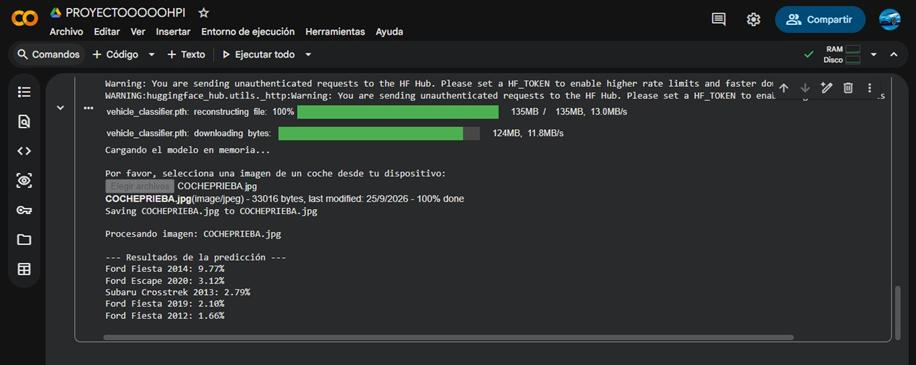

# [CHESSCAR]

> [CHESSCAR adivina tu carro en menos de lo que canta un gallo]

**Proyecto integrador · Herramientas de IA**

**Grupo:** [A1] · **Equipo:** [1]

## 👥 Integrantes

| Nombre completo | Matrícula |
|-----------------|-----------|
| [Raúl Chessani] | [198543-1] |
| [Erik Aguirre] | [198322-6] |
| [Cristopher Córtes] | [198111-6] |
| [Daniel Juaréz] | [198744-6] |
## 1. Caso de uso

[¿Qué necesidad resuelven y de quién es?]
Provedor de identificaión vehicular para administración de seguros, especificamente pueden darle un valor al vehiculo y sacar el procentaje que le puede asignar al usuario el límite o el presupuesto que puede ser asegurado por la empresa

- **Entrada:** [Imágenes]
- **Salida:** [Texto]
   ```markdown
   ## 🔀 Cómo funciona
   ```


## 2. Modelo abierto elegido

| Dato                         | Respuesta                                                                                                                                                                                                                                                                                                                                                           |
| ---------------------------- | ------------------------------------------------------------------------------------------------------------------------------------------------------------------------------------------------------------------------------------------------------------------------------------------------------------------------------------------------------------------- |
| Identificador                | [autor/modelo](https://huggingface.co/Jordo23/vehicle-classifier)                                                                                                                                                                                                                                                                                                   |
| Tarea (pipeline tag)         | `[image-classification]`                                                                                                                                                                                                                                                                                                                                            |
| Número de parámetros         | [ $\approx$ 19M ]                                                                                                                                                                                                                                                                                                                                                   |
| Licencia                     | [ MIT License ]                                                                                                                                                                                                                                                                                                                                                     |
| Limitación o sesgo declarado | [ Condiciones de imagen: Diseñado para fotos claras y bien iluminadas; decae en tomas ocluidas o con ángulos inusuales (cenitales, primeros planos extremos). - Cobertura: Presenta fallos con autos modificados/personalizados o modelos muy antiguos y raros ausentes en VMMRdb. - Alcance: No realiza detección de color de vehículo (debe procesarse aparte). ] |

## 3. Viabilidad de hardware

$$
\text{Memoria mínima} = 19000000 \times 2\ \text{bytes} \approx \ \ \text{0.38GB}
$$

- **VRAM disponible en Colab:** [ +15 ] GB ([D4])
- **Dónde se ejecuta:** [Colab con GPU]
- **Por qué:** [ Usamos servidores gratis ya que no neceitanos como poder de procesamiento ]

## 4. Riesgo ético

- **Riesgo:** [ La IA puede rastrear tu ubicación a tráves de camaras de transito públicas, ya que para eso se planeaba que hiciera la IA ]
- **Mitigación:** [ La sulocuión al problema es limitarlo el uso público y designar ciertas empresas que paguen nuestro servivcio ]

## 5. Evidencia




